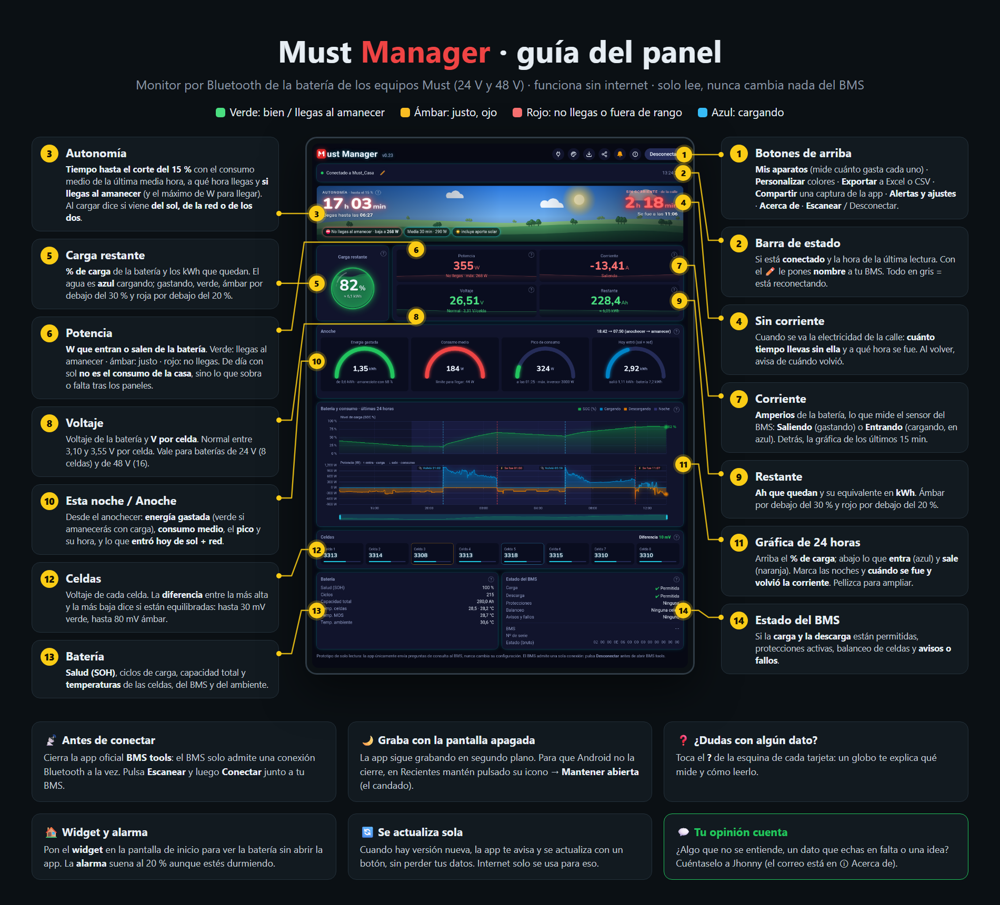

# Must Manager

App Android para vigilar por Bluetooth la batería LiFePO4 de los equipos solares todo en uno **Must HBP3000**: inversor y batería en el mismo mueble. Lee el BMS en tiempo real, guarda el historial en el dispositivo, dibuja gráficas, avisa cuando hace falta y exporta los datos a Excel o CSV.

**Funciona 100 % sin internet.** Está pensada para lugares con cortes largos de corriente, donde lo que importa es saber si la batería llega al amanecer.

> App no oficial, hecha por un usuario para usuarios. No está relacionada con MUST Power.



## Qué hace

- **Panel en tiempo real:** SOC, potencia, voltaje, corriente, las 8 o 16 celdas, temperaturas y estado del BMS.
- **Autonomía:** horas que quedan hasta el corte del inversor (15 % por defecto) y si llegas al amanecer, con la media de consumo de los últimos 30 minutos.
- **Historial y gráficas:** una lectura cada 10 s, también con la pantalla apagada. Incluye un resumen de la noche: energía gastada, consumo medio y pico.
- **Alertas:** batería baja (con alarma opcional que suena aunque esté en No molestar), llegada y corte de la corriente, aviso si no llegas al amanecer y pérdida de conexión.
- **Medidor de aparatos:** mide cuánto gasta cada aparato de la casa.
- **Widget** para la pantalla de inicio.
- **Exportar** a Excel (.xlsx, tres hojas) o CSV, sin librerías externas.

## Equipos compatibles

| Batería | Ejemplo | Estado |
|---|---|---|
| 24 V (8S) | Must HBP3000 LV | Probado |
| 48 V (16S) | Must HBP3300 TLV | Probado |

El BMS se anuncia por Bluetooth como `PC-XXXX` (software `P8S200A-…`). Con otras versiones de firmware la app muestra un error claro en lugar de datos raros.

## Seguridad: solo lectura

La app **nunca escribe nada en el BMS**. Solo envía 5 comandos de lectura, copiados tal cual de la app oficial y escritos como constantes en el código. Así es imposible desconfigurar las protecciones de la batería. Ver [`docs/protocolo_bms.md`](docs/protocolo_bms.md).

El Bluetooth del BMS admite una sola conexión: cierra la app oficial (BMS tools) antes de usar esta.

## Instalar

Descarga el `.apk` de la versión más reciente y ábrelo en el dispositivo Android (hay que permitir "instalar apps desconocidas"). Requiere Android 7 o superior con Bluetooth LE.

## Cómo está hecha

- **Interfaz:** HTML + JavaScript en [`app/`](app/), dentro de un WebView. Las gráficas usan ECharts (incluido en el repo, sin CDN).
- **Java** solo para lo que la web no puede hacer: Bluetooth, servicio en segundo plano, SQLite, alertas, widget y exportar ([`android/src/`](android/src/com/jhonny/mustmanager/)).
- **Sin Gradle ni Kotlin**, para no depender de descargas grandes: el APK se compila llamando directamente a las herramientas del SDK de Android.

### Compilar

Necesitas un JDK 17 y el SDK de Android con build-tools 35.0.0 y la plataforma android-34. Indica dónde están con `JAVA_HOME` y `ANDROID_HOME` (por defecto se buscan en `D:\Android\jdk17` y `D:\Android\sdk`). Después:

```powershell
.\android\build.ps1            # genera dist\MustManager-<versión>.apk
.\android\build.ps1 -Install   # además la instala por USB con adb
```

La primera vez se crea una llave de firma propia en `secretos\`, que está fuera de Git. Un APK firmado con otra llave no puede actualizar uno instalado: hay que desinstalar primero.

### Probar sin compilar

`app/index.html` funciona en Chrome con Web Bluetooth desde `localhost` y se conecta al BMS real. Sin BMS, `index.html?demo` muestra datos simulados.

### Pruebas

```powershell
.\tools\test-protocol.ps1      # protocolo (Java)
.\tools\test-xlsx.ps1          # escritor de .xlsx
node tools\test-webble.js      # protocolo (JS)
node tools\test-status.js      # trama de estado del BMS
node tools\check-html.js       # sintaxis e ids de index.html
```

## Contribuir

Los Pull Requests son bienvenidos. Para cambios grandes, abre antes un *issue* y lo hablamos. Antes de enviar, pasa las pruebas de arriba.

## Autor

Jhonny Valdes · yonivaldes82@gmail.com

## Licencia

© 2026 Jhonny Valdes · Licencia [GPL-3.0](LICENSE)
