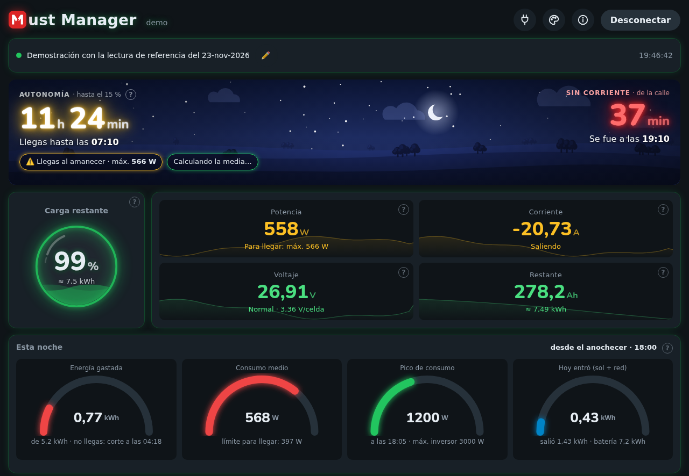
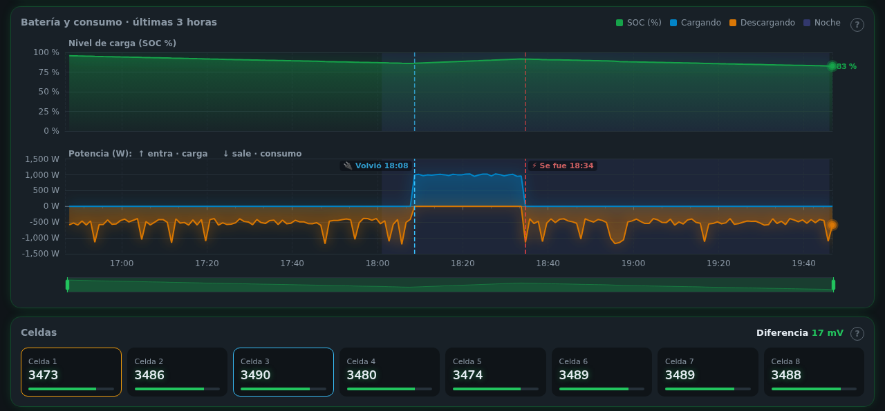
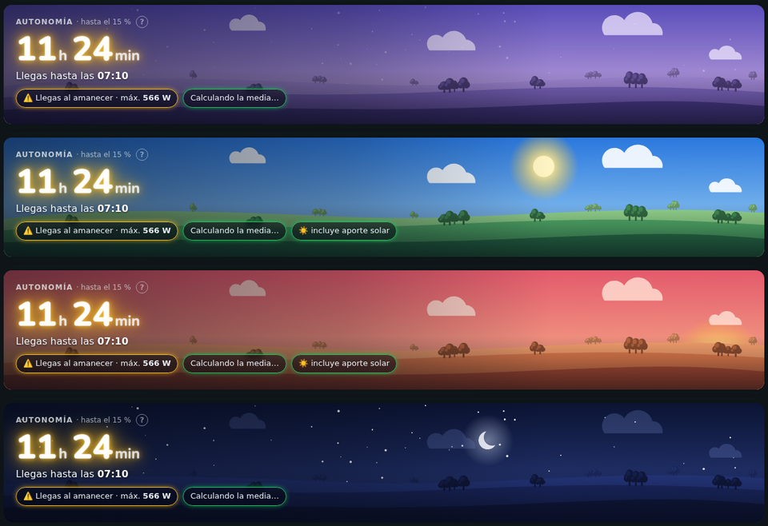
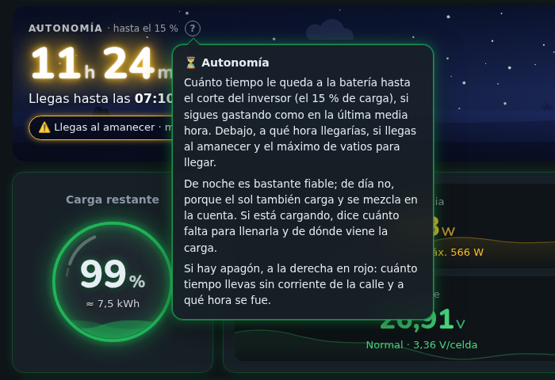
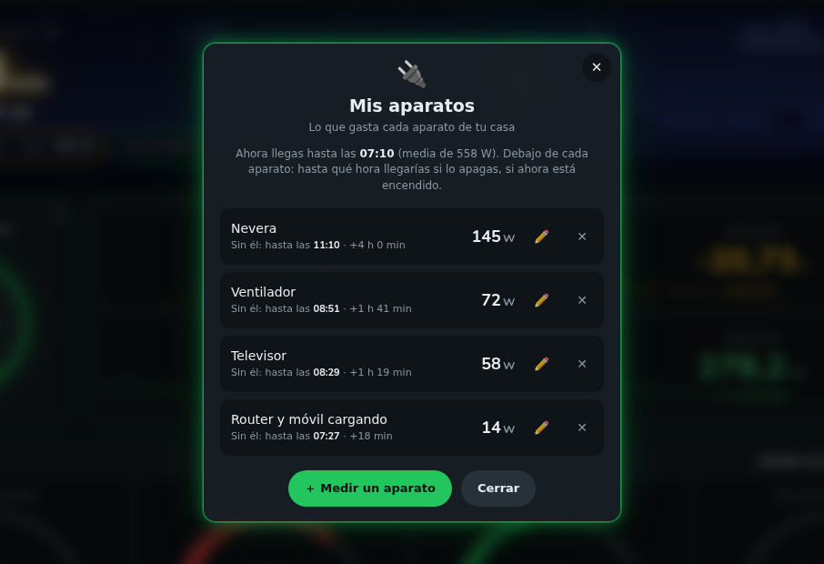
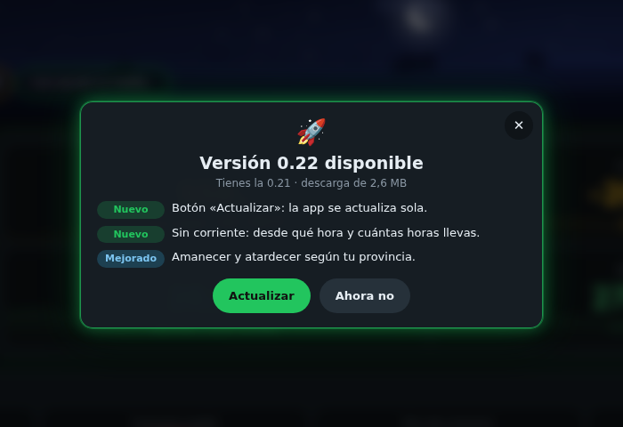
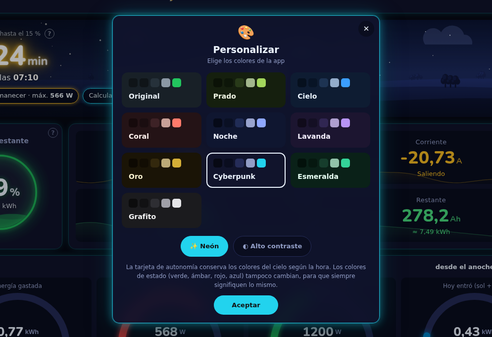

<div align="center">


# Must Manager

**Monitor por Bluetooth para la batería de los equipos solares Must HBP: funciona sin internet y solo lee el BMS.**

Mira en tiempo real cuánta batería te queda, a qué hora llegarías al corte y si aguantas hasta el amanecer.<br>
Historial, gráficas, alertas, avisos de apagón y exportación a Excel, todo guardado en tu propio dispositivo.

[](https://github.com/YoniValdes/must_manager/actions/workflows/pruebas.yml)
[](https://github.com/YoniValdes/must_manager/releases/latest)
[](LICENSE)


**[⬇️ Descargar la última APK](https://github.com/YoniValdes/must_manager/releases/latest)**



<sub>Capturas hechas con el modo de demostración (<code>index.html?demo</code>), con datos simulados.</sub>

</div>

---

> [!NOTE]
> Must Manager es una app **no oficial**, hecha por un usuario para otros usuarios. No está relacionada con MUST Power ni con la app oficial BMS tools.

## Por qué Must Manager

- **Responde a la pregunta que importa: ¿llego al amanecer?** Donde la corriente llega solo unas horas al día, lo que necesitas saber de noche es cuántas horas te quedan hasta el corte del inversor y cuántos vatios puedes gastar para llegar. La app lo calcula con tu consumo medio de los últimos 30 minutos y te lo dice con un veredicto claro.
- **Sabe cuándo se fue la corriente.** Si hay un apagón, muestra desde qué hora y cuántas horas llevas sin corriente de la calle, y te avisa cuando vuelve.
- **Funciona sin internet.** Todo (lecturas, historial, gráficas, alertas) va en el dispositivo. Internet solo se usa, si lo hay, para buscar actualizaciones de la propia app.
- **Solo lectura, por diseño.** La app solo envía al BMS 5 preguntas de consulta, escritas como constantes en el código. Nunca construye otras tramas, así que es imposible que cambie la configuración o las protecciones de tu batería.
- **El historial que le falta a la app oficial.** La pestaña «Historical data» de BMS tools está vacía. Must Manager graba una lectura cada 10 segundos, también con la pantalla apagada, y te deja exportarlas a Excel.
- **Ligera.** Una interfaz HTML + JavaScript dentro de un WebView y un poco de Java para el Bluetooth. Sin Gradle, sin Kotlin y con todo incluido en la APK, sin descargar nada: pesa unos 500 KB.

## Capturas

<table>
  <tr>
    <td colspan="2"><br><sub><b>Batería y consumo</b>: SOC arriba; carga (azul) y consumo (naranja) abajo, con zoom, la noche sombreada y los apagones marcados («Se fue» / «Volvió»). Debajo, el voltaje de cada celda.</sub></td>
  </tr>
  <tr>
    <td width="50%"><br><sub><b>Autonomía</b>: el cielo sigue la hora real, con el amanecer y el atardecer de tu provincia.</sub></td>
    <td width="50%"><br><sub><b>Ayuda</b>: el «?» de cada tarjeta explica qué mide y cómo leerla.</sub></td>
  </tr>
  <tr>
    <td><br><sub><b>Mis aparatos</b>: cuánto gasta cada aparato y hasta qué hora llegarías si lo apagas.</sub></td>
    <td><br><sub><b>Actualizaciones</b>: avisa de las versiones nuevas y se actualiza con un botón.</sub></td>
  </tr>
  <tr>
    <td><br><sub><b>Personalizar</b>: 10 paletas, efecto neón y alto contraste.</sub></td>
    <td><a href="docs/infografia/guia_del_panel.png"></a><br><sub><b>Guía del panel</b>: cada parte explicada, lista para compartir.</sub></td>
  </tr>
</table>

## Funciones

<details open>
<summary><b>Panel en tiempo real</b></summary>

- «Carga restante» como un depósito de agua que sube y baja con el SOC, más potencia, corriente, voltaje (también por celda) y capacidad restante en Ah y kWh.
- Colores de estado que no cambian con la paleta: **verde** vas bien, **ámbar** justo, **rojo** no llegas o fuera de rango, **azul** cargando. Siempre acompañados de texto.
- Detrás de cada número, una gráfica pequeña con su evolución de los últimos 15 minutos.
- Voltaje de cada celda y diferencia entre la más alta y la más baja, para vigilar el equilibrado.
- Salud (SOH), ciclos, capacidad total y temperaturas de las celdas, de los MOS y del ambiente.
- Estado del BMS: carga y descarga permitidas o cortadas, protecciones, balanceo, avisos y fallos.
- Un «?» en cada tarjeta que abre un globo con su explicación.
</details>

<details open>
<summary><b>Autonomía y apagones</b></summary>

- Horas que quedan hasta el corte del inversor (15 % de SOC por defecto, configurable), con el consumo medio de los últimos 30 minutos. En la APK esa media se rellena con el historial, así que es estable desde que abres la app.
- Hora a la que llegarías y veredicto: «Llegas al amanecer» o «No llegas · baja a N W», con los vatios máximos que puedes gastar para llegar.
- Amanecer y atardecer de cada día calculados en el dispositivo (fórmula de la NOAA, sin internet) según tu provincia de Cuba, o a mano.
- **Sin corriente:** cuando se va la electricidad de la calle, muestra desde qué hora y cuántas horas llevas sin ella (también en el widget), y «Volvió la corriente» cuando regresa. Si la app no lo detecta, puedes marcarlo tú con «¿Ya volvió?».
- Al cargar, dice de dónde viene la energía: del sol, de la red o de los dos.
- Escena del cielo animada según la hora (alba, mañana, día, atardecer, crepúsculo y noche) que respeta la opción de animaciones reducidas del sistema.
</details>

<details open>
<summary><b>Historial y gráficas</b> (APK)</summary>

- Registro en segundo plano en SQLite, una lectura cada 10 segundos, también con la tablet bloqueada (servicio en primer plano con notificación fija y botón Desconectar).
- Gráfica «Batería y consumo» con zoom (pellizcando o con la barra de abajo), la noche sombreada y los apagones marcados. Los ratos sin datos (app cerrada) se ven como huecos, sin inventar valores.
- «Esta noche / Anoche»: energía gastada frente a la disponible, consumo medio frente al límite para llegar, pico de consumo frente a la potencia del inversor y energía que entró hoy (sol + red).
</details>

<details open>
<summary><b>Alertas</b> (APK, funcionan con la pantalla apagada)</summary>

- **Batería baja:** aviso al 30 % y urgente al 20 %. Al urgente puede sonar además una **alarma** por el canal de alarmas del sistema, que sube de volumen poco a poco y se oye aunque esté activado No molestar.
- **Llegó la corriente / se fue la corriente** de la red.
- **No llegas al amanecer:** solo de noche, y vuelve a avisar solo si la previsión empeora.
- **Sin conexión** con el BMS durante más de 5 minutos, con aviso cuando se recupera.
- Botones para probar una alerta y la alarma.
</details>

<details open>
<summary><b>Herramientas</b></summary>

- **Mis aparatos:** mide cuánto gasta un aparato comparando el consumo de la casa antes y después de encenderlo. Debajo de cada uno, hasta qué hora llegarías si lo apagas.
- **Exportar** a Excel (`.xlsx` con tres hojas: lecturas cada 10 s, resumen por hora y estado del BMS) o a CSV, de las últimas 24 h, 7 días, 30 días o de todo el historial. El `.xlsx` se escribe sin librerías y se guarda en *Descargas/MustManager* (APK).
- **Compartir una captura** de la app entera, en calidad alta, media o baja (para ahorrar datos) y en una imagen o en 3 partes, mejor para WhatsApp (APK).
- **Widget** para la pantalla de inicio: SOC, consumo, autonomía con el veredicto del amanecer y aviso de apagón, sobre el mismo cielo de la app.
- **Actualizaciones con un botón:** la app avisa cuando hay una versión nueva en *Releases* y se actualiza sin perder tus datos (APK).
- **Nombre propio para cada BMS** (Casa, Taller…), útil si hay varios cerca. Se guarda solo en tu dispositivo, nunca en el BMS.
- 10 paletas de color, efecto neón y alto contraste. Ventana de novedades tras cada actualización.
</details>

## Equipos compatibles

| Batería | Equipo de ejemplo | Estado |
|---|---|---|
| LiFePO4 24 V (8S) | Must HBP3000 LV | Equipo de referencia del desarrollo |
| LiFePO4 48 V (16S) | Must HBP3300 TLV | Probado por un usuario |

- La app detecta sola el número de celdas, la capacidad y los kWh de tu batería.
- El BMS se anuncia por Bluetooth como `PC-XXXX` (servicio BLE `FFF0`). El de referencia tiene el software `P8S200A-41080-1.03` y el hardware `21887V130`.
- Si un BMS responde de forma distinta a la esperada, la app muestra un error claro en vez de datos sin sentido.
- **Varias baterías en paralelo:** la app lo detecta y avisa, pero de momento muestra solo los datos de la batería 1.

## Primeros pasos

Must Manager está en **beta**: la usan el autor y varios amigos con el mismo equipo. La v1.0 llegará tras unas semanas de uso sin fallos graves.

### Instalar la APK

Requisitos: Android 7.0 o superior con Bluetooth LE.

1. Descarga `MustManager-<versión>.apk` de la [**última versión**](https://github.com/YoniValdes/must_manager/releases/latest), ábrela y permite «Instalar aplicaciones desconocidas» cuando Android lo pida. Solo hace falta la primera vez: después la app se actualiza sola con un botón.
2. **Cierra BMS tools:** el Bluetooth del BMS solo admite una conexión a la vez.
3. Abre Must Manager, pulsa **Escanear** y luego **Conectar** junto a tu BMS (`PC-…`). Concede los permisos de «Dispositivos cercanos» y de notificaciones.
4. En la campana 🔔 (**Alertas y ajustes**) indica los datos de tu equipo: provincia (para el amanecer y el atardecer), % de corte del inversor y potencia del inversor y de los paneles.

> [!TIP]
> - **Acerca la tablet a la batería** si no conecta o se desconecta: con una señal de unos −90 dBm el Bluetooth deja de funcionar.
> - En Samsung, activa el candado **«Mantener abierta»** de la app en la vista de recientes (la app te lo explica la primera vez que conecta). Si la quitas de recientes, Android cierra también el servicio y deja de grabar.

### Probar la interfaz en el navegador

`app/index.html` funciona también como página web y se conecta al BMS real con Web Bluetooth (Chrome, desde `localhost` o `https`):

```sh
cd app
python3 -m http.server 8000      # en Termux sin Python: busybox httpd -f -p 8000
```

Abre `http://localhost:8000` en Chrome. Sin la APK no hay historial, alertas, exportación, widget ni actualizaciones, porque dependen de la parte en Java.

Sin BMS, puedes revisar el diseño con estos parámetros:

| Parámetro | Qué hace |
|---|---|
| `?demo` | Datos de ejemplo y 3 horas de historial simulado |
| `&hora=HH:MM` | Dibuja el cielo de la autonomía a esa hora |
| `&apagon=HH:MM`, `&volvio=HH:MM`, `&apagon=no` | Simula un apagón, la vuelta de la corriente o una hora desconocida |
| `&tema=cyber&neon=0&hc=1` | Prueba una paleta, sin neón y con alto contraste (no se guarda) |
| `&ayuda=eta` | Abre el globo de ayuda de una tarjeta (`eta`, `socCard`, `kPower`, `nightCard`, `chartCard`…) |
| `?panel=aparatos`, `tema`, `actualizar`, `candado`, `about` | Abre directamente esa ventana |
| `?novedades` | Muestra la ventana de novedades |
| `?debug` | Diagnóstico de las tramas recibidas en los primeros segundos |

### Compilar la APK

La APK se compila **sin Gradle**, llamando directamente a las herramientas del SDK de Android con [`android/build.ps1`](android/build.ps1) (PowerShell, Windows).

Necesitas:

- JDK 17.
- SDK de Android con *build-tools* 35.0.0 y la plataforma `android-34` (y *platform-tools* para instalar por USB).
- Las variables `JAVA_HOME` y `ANDROID_HOME` (si no están, el script usa `D:\Android\jdk17` y `D:\Android\sdk`).

```powershell
.\android\build.ps1            # genera dist\MustManager-<versión>.apk
.\android\build.ps1 -Install   # además la instala por USB con adb
```

El script hace seis pasos: recursos (`aapt2`), Java 8 (`javac --release 8`), DEX (`d8`), empaquetado de la interfaz, `zipalign` y firma (`apksigner`).

También se puede compilar en GitHub: *Actions* → **Compilar APK** → *Run workflow* ([`apk.yml`](.github/workflows/apk.yml)). Usa el mismo script, toma la llave de firma de los *secrets* del repositorio y, si se marca «Publicar como Release», publica la APK en *Releases*.

> [!IMPORTANT]
> La primera vez que compilas en tu PC se crea una llave de firma en `secretos\` (fuera de Git). **Haz copia de seguridad:** Android solo deja actualizar una app con una APK firmada con la misma llave. Con otra llave habría que desinstalar la app, y se perdería el historial.

## Cómo funciona

```
 Batería LiFePO4 ── BMS
                     │  Bluetooth LE (servicio FFF0)
                     ▼
 ┌─────────────────────────── APK ────────────────────────────┐
 │  BmsClient + BmsProtocol   (5 preguntas de lectura)        │
 │        │                                                   │
 │        ▼                                                   │
 │  MonitorService ─┬─► ReadingStore (SQLite, cada 10 s)      │
 │  (primer plano)  ├─► AlertManager + AlarmPlayer            │
 │        │         ├─► GridWatch (apagones)                  │
 │        │         └─► BatteryWidget                         │
 │        ▼                                                   │
 │  MainActivity: WebView con app/index.html                  │
 │  (interfaz HTML + JS + ECharts, puente «Android»)          │
 │                                                            │
 │  Updater ◄── Releases de GitHub (1 consulta al día)        │
 └────────────────────────────────────────────────────────────┘
```

- El BMS funciona por **pregunta y respuesta**: no envía nada si no se le pregunta. La app le pregunta cada pocos segundos con las tramas de la lista blanca.
- Las tramas son binarias, con el formato `9A … 9D` y un CRC-16/MODBUS. El protocolo se descifró a partir del tráfico Bluetooth entre la app oficial y el BMS (registro HCI de Android) y se validó con una lectura de referencia. Está documentado en [`docs/protocolo_bms.md`](docs/protocolo_bms.md).
- El BMS solo ve la corriente neta de la batería (sol + red − consumo). Los apagones se deducen de ella: con el inversor en modo UTI, mientras hay red la batería no se descarga.
- La interfaz es la misma en la APK y en el navegador: en la APK recibe los datos del puente Java; en Chrome, de [`app/webble.js`](app/webble.js) por Web Bluetooth.

## Seguridad y privacidad

- **Solo lectura:** la app solo conoce 5 tramas de consulta, escritas como constantes (ver la tabla en [`docs/protocolo_bms.md`](docs/protocolo_bms.md)). No hay ningún código que construya tramas a partir de datos, así que no puede escribir parámetros en el BMS.
- **Internet, solo para actualizarse:** una vez al día, si hay conexión, la app pregunta a la API pública de GitHub cuál es la última versión (una respuesta de unos 2 KB) y solo descarga la APK si pulsas «Actualizar». Es una petición anónima: nunca envía datos de la batería ni tuyos. Sin conexión, la app funciona exactamente igual, y el aviso se puede desactivar en Acerca de.
- **Instalación siempre confirmada:** Android pide confirmar cada actualización y solo acepta una APK firmada con la misma llave, así que una APK ajena no puede sustituir a la app.
- **Tus datos se quedan en tu dispositivo:** el historial está en una base de datos SQLite de la app, y los ajustes y nombres en el almacenamiento local. La copia de seguridad automática de Android está desactivada (`allowBackup="false"`).
- **Sin navegación externa:** el WebView no abre ninguna página fuera de la propia app (salvo los enlaces de correo).
- **Permisos de Bluetooth:** en Android 12 o superior se usa «Dispositivos cercanos» marcado como `neverForLocation`. En Android 11 o anterior, Android exige el permiso de ubicación para buscar dispositivos BLE, pero la app no lo usa para localizarte.

## Estructura del proyecto

```
app/                         interfaz (HTML + JS); también funciona sola en Chrome
  index.html                 panel, gráficas, ventanas, ayudas y ajustes
  webble.js                  protocolo del BMS en JavaScript (Web Bluetooth)
  status.js                  lectura de la trama de estado del BMS
  changelog.js               novedades que ve el usuario tras actualizar
  fonts/                     Nunito (números redondeados), local (OFL)
  vendor/                    ECharts 5.6.1, local (Apache-2.0)
android/
  AndroidManifest.xml        versión, permisos y componentes
  build.ps1                  compilación sin Gradle
  res/                       icono, widget y textos
  src/com/jhonny/mustmanager/
    MainActivity.java        WebView y puente Java ↔ página
    BmsClient.java           conexión BLE y reconexión automática
    BmsProtocol.java         tramas de la lista blanca y su interpretación
    MonitorService.java      servicio en primer plano y registro
    ReadingStore.java        historial en SQLite
    AlertManager.java        alertas y detección de la red
    AlarmPlayer.java         alarma sonora de batería baja
    GridWatch.java           apagones: «Sin corriente» y «Volvió»
    Sun.java                 amanecer y atardecer (NOAA, sin internet)
    BatteryWidget.java       widget de la pantalla de inicio
    Exporter.java            exportación a CSV y .xlsx
    XlsxWriter.java          escritor de .xlsx sin librerías
    Screenshot.java          captura de la app para compartir
    Updater.java             búsqueda y descarga de actualizaciones
    InstallReceiver.java     resultado de la instalación
    Settings.java            ajustes validados
.github/workflows/
  pruebas.yml                pruebas en cada Pull Request y en cada push a main
  apk.yml                    compilación de la APK y publicación en Releases
docs/
  protocolo_bms.md           protocolo BLE descifrado
  lectura_referencia_*.md    lectura completa usada para validar el protocolo
  infografia/                guía visual del panel
  capturas/                  imágenes de este README
tools/                       pruebas
```

## Desarrollo

### Pruebas

GitHub Actions las ejecuta en cada *Pull Request* ([`pruebas.yml`](.github/workflows/pruebas.yml)), pero conviene pasarlas antes:

```powershell
.\tools\test-protocol.ps1      # protocolo en Java, con tramas reales capturadas
.\tools\test-xlsx.ps1          # escritor de .xlsx (lo lee con SheetJS; ver la ruta en el script)
node tools\test-webble.js      # protocolo en JavaScript
node tools\test-status.js      # trama de estado del BMS
node tools\check-html.js       # sintaxis de index.html, ids repetidos y $("id") inexistentes
```

En Linux o macOS, la prueba del protocolo en Java sin PowerShell:

```sh
javac -encoding UTF-8 -d android/build/test android/src/com/jhonny/mustmanager/BmsProtocol.java tools/ProtocolTest.java
java -cp android/build/test ProtocolTest
```

### Publicar una versión

1. Sube `versionCode` (+1) y `versionName` en [`android/AndroidManifest.xml`](android/AndroidManifest.xml).
2. Añade **arriba** de [`app/changelog.js`](app/changelog.js) una entrada con ese mismo número: frases cortas pensadas para el usuario, marcadas como `new` (Nuevo), `fix` (Corregido) o `imp` (Mejorado).
3. Si cambió algún `.js` propio, sube su `?v=N` en `index.html` para que Chrome no use la versión en caché.
4. Lanza **Compilar APK** desde `main` con «Publicar como Release». Las apps instaladas verán la versión nueva en su siguiente consulta diaria.

### Reglas del proyecto

Si quieres contribuir, ten en cuenta estas reglas:

- **Nunca escribir en el BMS.** Solo se añaden comandos de lectura copiados de capturas de BMS tools, y siempre como constantes en la lista blanca.
- **Internet, opcional y mínimo.** La app tiene que funcionar igual sin conexión. Cualquier uso nuevo de la red debe ser pequeño, opcional y avisado, y nunca enviar datos del usuario ni de la batería.
- **Java 8 sin lambdas, sin Gradle ni Kotlin**, para poder compilar sin descargas grandes.
- **Nada de `alert()`, `confirm()` ni `prompt()`** en `index.html`: el WebView de la APK no los muestra. Las confirmaciones se hacen dentro de la página.
- Las ventanas emergentes usan la estructura `.modal` común, con los botones centrados.
- No subas registros de Bluetooth (`btsnoop_hci.log`), informes de errores ni capturas con el número de serie del BMS: son datos personales.

Los *issues* y los *Pull Requests* son bienvenidos. Para cambios grandes, abre antes un *issue* y lo hablamos.

## Hoja de ruta

- **Leer el inversor** por USB, para separar el aporte de los paneles, el de la red y el consumo real de la casa (el BMS solo ve la corriente neta de la batería).
- Total de varias baterías en paralelo.
- Versión del firmware del BMS y los bits de estado que faltan por confirmar.
- v1.0, tras la beta con amigos.

## Aviso

Must Manager es un proyecto independiente y no oficial: no está afiliado a MUST Power, ni cuenta con su respaldo o patrocinio. «Must» y los nombres de los equipos son marcas de sus respectivos dueños; el icono de la app es un diseño propio.

La autonomía es una **estimación**. De noche suele acertar con un margen del 10–20 %; de día incluye el aporte del sol y no es fiable. Fíjate más en el veredicto («Llegas · máx. N W») que en el número exacto. La app se ofrece tal cual, sin garantías (ver la licencia).

## Licencia

© 2026 Jhonny Valdes · [GPL-3.0](LICENSE)

Incluye [ECharts](https://echarts.apache.org) (Apache-2.0) y la fuente [Nunito](app/fonts/Nunito-OFL.txt) (SIL Open Font License).

## Autor

Hecho por **Jhonny Valdes** ([@YoniValdes](https://github.com/YoniValdes))

¿Una idea, un fallo o una duda? Abre un [*issue*](https://github.com/YoniValdes/must_manager/issues).
